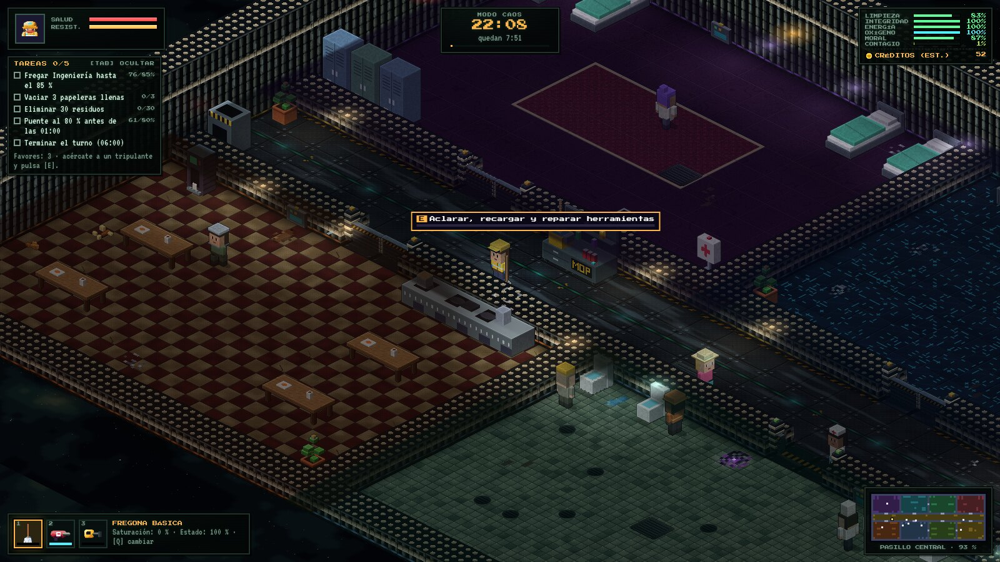
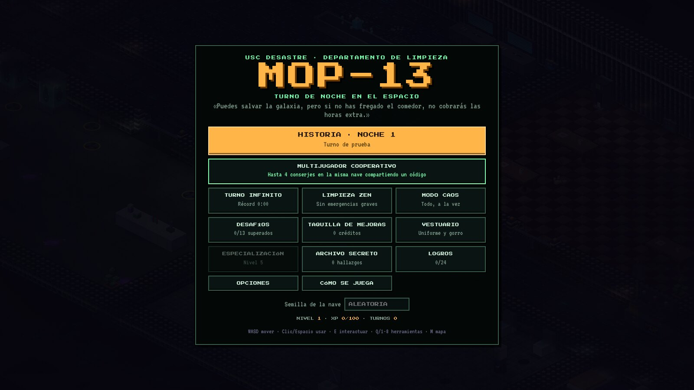
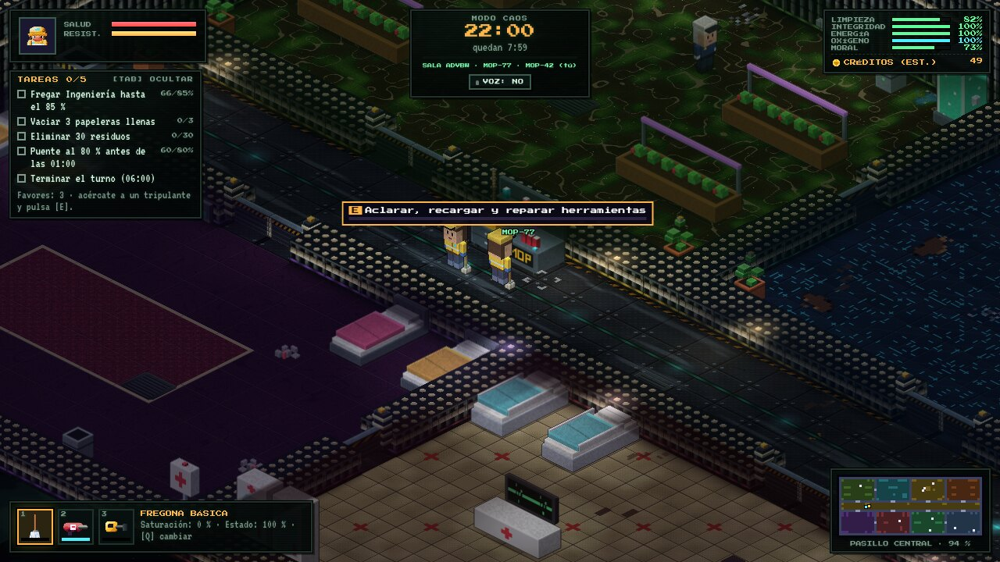
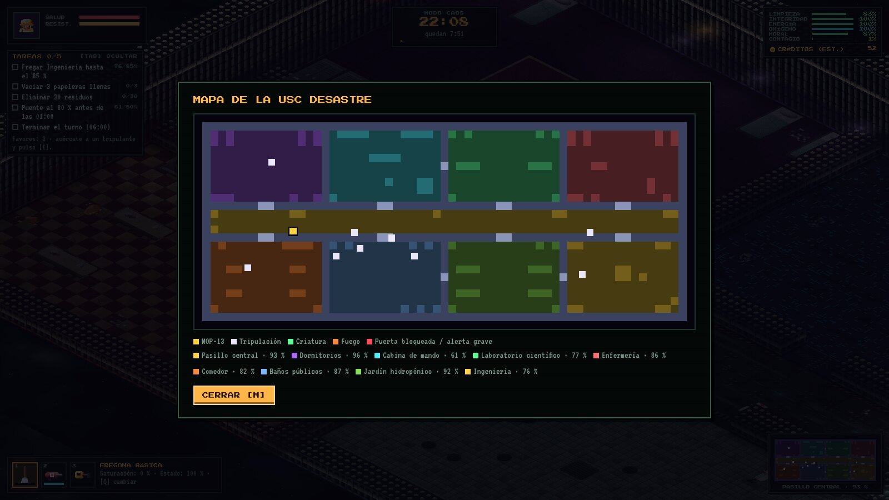
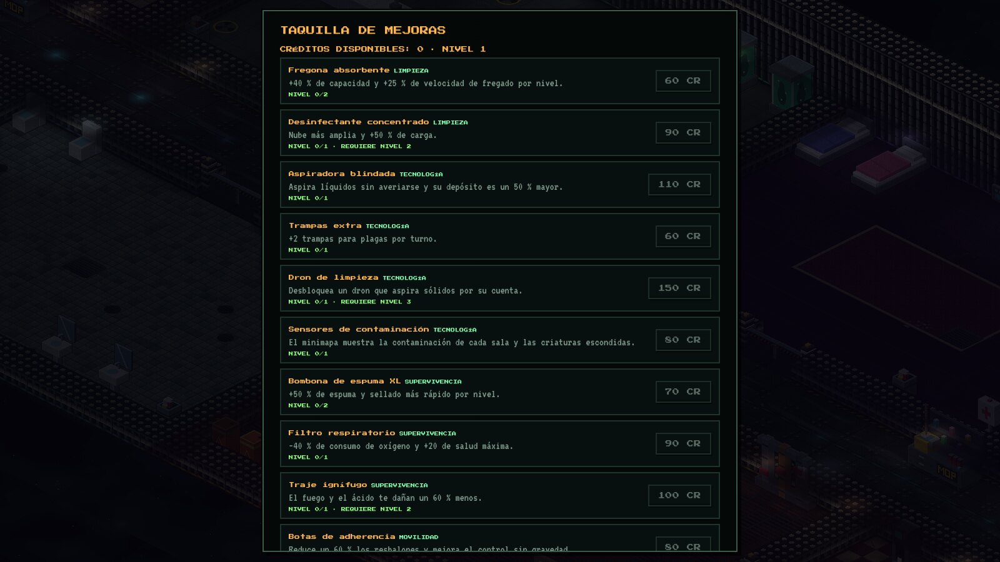
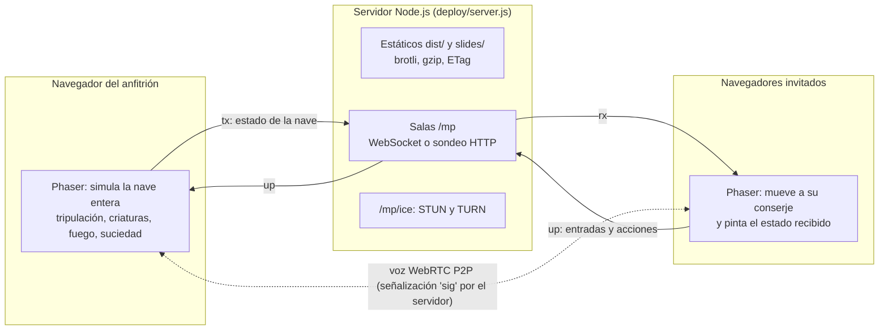

# MOP-13 · Turno de noche en el espacio

> «Puedes salvar la galaxia, pero si no has fregado el comedor, no cobrarás las horas extra.»

**Trabajo Fin de Máster · Máster de Desarrollo con IA**

MOP-13 es un simulador de conserje espacial con humor, en pixel art y con multijugador cooperativo online. Eres el
conserje del turno de noche de la nave **USC Desastre**: friegas, recoges, desatascas, capturas fauna alienígena y
sobrevives a incendios, brechas y jefes mientras la tripulación lo ensucia todo. Se juega en el navegador, sin
instalar nada, solo o con hasta 3 amigos más y chat de voz.

| Recurso | Enlace |
|---|---|
| 🎮 **Juego desplegado** | https://khaki-elk-914724.hostingersite.com |
| 💻 **Código fuente** | https://github.com/nastxp/mop-13-turno-de-noche |
| 🖥️ **Slides (HyperFrames)** | https://khaki-elk-914724.hostingersite.com/slides/ · [PDF en el repositorio](slides/MOP-13-presentacion.pdf) |
| 🎬 **Vídeo de presentación** | _Pendiente: añadir aquí la URL pública del vídeo_ |
| 🔑 **Usuario y contraseña de prueba** | No hacen falta: el juego no tiene login |



---

## Índice

1. [Descripción general](#1-descripción-general)
2. [Funcionalidades principales](#2-funcionalidades-principales)
3. [Stack tecnológico](#3-stack-tecnológico)
4. [Arquitectura](#4-arquitectura)
5. [Instalación y ejecución](#5-instalación-y-ejecución)
6. [Estructura del proyecto](#6-estructura-del-proyecto)
7. [Despliegue](#7-despliegue)
8. [Presentación (slides)](#8-presentación-slides)
9. [Vídeo](#9-vídeo)
10. [Usuario y contraseña de prueba](#10-usuario-y-contraseña-de-prueba)

---

## 1. Descripción general

Los juegos de naves espaciales suelen ponerte en el puesto del capitán. MOP-13 cuenta la misma crisis desde abajo:
eres **MOP-13**, el conserje del turno de noche, y tu trabajo es que la nave esté limpia a las 06:00 mientras
todo se rompe a tu alrededor.

Cada turno empieza con un memorándum que asigna las tareas de la noche (fregar una sala hasta un porcentaje,
vaciar papeleras, eliminar residuos…). A partir de ahí la nave se simula sola: los tripulantes comen, duermen, van
al baño y trabajan, y por el camino ensucian, rompen cosas y provocan incidentes. Hay incendios, fugas de oxígeno,
plagas, apagones, inspectores corporativos y criaturas en la ventilación. Al final del turno recibes un informe con
créditos y experiencia para mejorar al conserje.

El tono es de comedia absurda («Si algo arde, puede ayudar. Si algo se mueve y es verde, no lo moje»), pero el
juego tiene sistemas reales: una simulación de necesidades para cada tripulante, emergencias encadenadas,
herramientas con carga y desgaste, progresión persistente y un multijugador cooperativo online con voz.
Todos los gráficos se generan por código: el repositorio no contiene ni una imagen del juego.

| Menú principal | Multijugador cooperativo (2 conserjes en la misma nave) |
|---|---|
|  |  |
| **Mapa de la nave** | **Taquilla de mejoras** |
|  |  |

## 2. Funcionalidades principales

### La nave
- **8 salas y un pasillo central**: cabina de mando, comedor, baños públicos, laboratorio científico, ingeniería,
  dormitorios, enfermería y jardín hidropónico. El minimapa (`M`) muestra el porcentaje de limpieza de cada sala.
- **12 tipos de tripulante** (capitán, científica, ingeniero, cocinero, turista espacial, inspector corporativo,
  médica, robot de mantenimiento, seguridad, diplomático alienígena, pasajero paranoico y contrabandista).
  Cada uno tiene necesidades (hambre, fatiga, vejiga, trabajo y vida social) y elige qué hacer para cubrirlas.
- **29 tipos de incidente** en cuatro categorías:
  - *Cotidianos*: vómitos, bandejas al suelo, inodoros atascados, tuberías con fugas, la cafetera que explota…
  - *Técnicos*: cortocircuitos, incendios eléctricos, fugas de oxígeno, pérdida de gravedad, reactor sobrecalentado, apagón general.
  - *Invasiones*: Rasgadores, brotes de enfermedad, moho, roedores de chatarra, enjambres devoracables, babosa gigante…
  - *Absurdos*: el capitán organiza una fiesta, una tormenta espacial, la IA de la nave declara una mancha obra de arte, los altavoces mienten…
- **Fauna que contraataca**: glorps, Rasgadores, babosas, ratas, insectos y aspiradoras rebeldes.
- **Indicadores de la nave**: limpieza, integridad, energía, oxígeno, moral y contagio.
- **Dos estilos gráficos**, a elegir en *Opciones → Estilo gráfico*: **bloques isométricos** (por defecto) o **pixel art 3/4** (clásico).

### Las herramientas (teclas 1–8)
| Tecla | Herramienta | Para qué sirve |
|---|---|---|
| 1 | Fregona básica | Limpia casi todo; se satura y deja el suelo mojado (la gente resbala) |
| 2 | Pistola de espuma selladora | Sella fugas y apaga fuegos |
| 3 | Aspiradora espacial | Sólidos y criaturas; hay que vaciar el depósito |
| 4 | Desinfectante industrial | Moho, contagios y curar tripulantes |
| 5 | Pulverizador criogénico | Congela lo que se mueve |
| 6 | Trampas para plagas | Roedores e insectos |
| 7 | Dron de limpieza | Aspira sólidos por su cuenta (mejora desbloqueable) |
| 8 | Superfregona experimental | El legado de MOP-1 (secreto) |

### Modos de juego
- **Historia**: un turno de prueba y 9 noches con misión propia. Tres terminan con un jefe: el Glorp del Baño 7,
  la Reina del Moho y el Rey Aspirador.
- **Turno infinito**: aguantar todo lo posible y batir el récord.
- **Limpieza zen**: sin emergencias graves.
- **Modo caos**: todo a la vez.
- **13 desafíos**: 4 con reglas especiales (*Sin agua*, *A oscuras*, *Turno exprés*, *Solo fregona*) y las 9 misiones de la historia sueltas.
- **Semilla de nave**: con la misma semilla se genera la misma nave.

### Progresión (se guarda en el navegador)
- **Créditos y experiencia** al final de cada turno.
- **Taquilla de mejoras**: 12 mejoras en 5 ramas (Limpieza, Tecnología, Supervivencia, Movilidad y Mantenimiento).
- **Especialización** a partir del nivel 5: conserje sanitario, técnico de emergencias, cazador de plagas o especialista antigravedad.
- **Vestuario**: 5 uniformes y 8 gorros que se desbloquean por nivel.
- **24 logros** y un **archivo secreto** con notas escondidas bajo la suciedad, un calcetín misterioso, un inodoro profético…

### Multijugador cooperativo online
- Hasta **4 conserjes** en la misma nave. El anfitrión crea una sala y comparte un **código de 5 letras** o un enlace `?sala=CÓDIGO`.
- El anfitrión elige el modo (Historia, Infinito, Zen o Caos). Quien entra más tarde aparece directamente en la nave.
- Si un conserje cae, Recursos Humanos envía un repuesto a los 10 s.
- Al terminar, todos reciben el mismo informe y cada uno cobra en su propia partida guardada.
- **Chat de voz** en la sala y en la pausa: micrófono abierto o pulsar para hablar (`V`), y voz por proximidad opcional.
- Si el alojamiento bloquea WebSocket, el juego cambia solo a sondeo HTTP.

### Controles
| Acción | Teclado y ratón |
|---|---|
| Moverse / correr | `W` `A` `S` `D` / `Shift` |
| Usar herramienta | Clic o `Espacio` |
| Cambiar herramienta | `Q` o `1`–`8` |
| Interactuar (mantener) | `E` |
| Tareas · mapa · pausa | `Tab` · `M` · `Esc` |
| Silenciar / hablar (multijugador) | `V` |

En pantallas táctiles aparecen controles en pantalla (se pueden forzar en *Opciones*).

## 3. Stack tecnológico

| Capa | Tecnología | Detalle |
|---|---|---|
| Lenguaje | **TypeScript 5.8** | Modo `strict`; unas 18.000 líneas en `src/` |
| Motor del juego | **Phaser 3.90** | Escenas, entrada, cámara y render en canvas/WebGL |
| Build | **Vite 6** | Servidor de desarrollo y bundle de producción en `dist/` |
| Gráficos | **Generados por código** | Pixel art y bloques isométricos dibujados al arrancar (`src/gfx/`); no hay ficheros de imagen |
| Sonido | **Web Audio API** | Efectos sintetizados en el navegador (`src/systems/AudioManager.ts`) |
| Interfaz | HTML + CSS | Menús y HUD encima del canvas (`src/ui/`); fuentes *Press Start 2P* y *VT323* |
| Tiempo real | **WebSocket (RFC 6455) propio** + sondeo HTTP largo | Salas del multijugador, sin librerías |
| Voz | **WebRTC** | Audio directo entre navegadores; STUN público y TURN opcional |
| Servidor | **Node.js ≥ 18 sin dependencias** | Solo módulos nativos: `http`, `fs`, `path`, `zlib`, `crypto` |
| Persistencia | `localStorage` | Partida guardada, nombre de jugador y ajustes de voz |
| Despliegue | **Hostinger** (aplicación Node.js) | También preparado para VPS con PM2 + Nginx |
| Presentación | **HyperFrames 0.9.86** + GSAP | Slides hechas con HTML, navegables en el navegador |

## 4. Arquitectura

### El juego (`src/`)

- `main.ts` crea el juego de Phaser con dos escenas: `BootScene` genera todas las texturas por código y `GameScene`
  lleva la partida.
- La partida se reparte en **sistemas** independientes (`src/systems/`): limpieza, emergencias, contaminación,
  enfermedades, combate, jefes, iluminación, vista isométrica, misiones, evaluación, guardado, secretos, humor…
  Se comunican mediante un bus de eventos (`src/core/EventBus.ts`).
- Las **entidades** (`src/entities/`) son el conserje, la tripulación (con su simulación de necesidades) y las criaturas.
- Los **datos** del juego (`src/data/`) están separados de la lógica: salas, herramientas, residuos, tripulación,
  incidentes, misiones, mejoras y textos.
- La aleatoriedad usa un generador con semilla (`src/core/Rng.ts`); por eso la misma semilla genera la misma nave.

### El multijugador



- **El anfitrión manda**: su navegador simula la nave completa y envía el estado a los invitados (`src/net/Sync.ts`).
  Los invitados solo envían sus entradas y el anfitrión aplica sus herramientas, así que la suciedad que friega uno
  desaparece para todos.
- **El servidor solo reenvía mensajes** entre los miembros de cada sala (`create`, `join`, `tx`, `up`, `sig`, `bye`,
  `ping`). No guarda nada: las salas viven en memoria.
- **Dos transportes** (`src/net/Net.ts`): WebSocket implementado a mano sobre `http` (con ping cada 25 s y límite de
  4 MB por mensaje) y, como alternativa, sondeo largo HTTP en `/mp/open`, `/mp/send`, `/mp/recv` y `/mp/close`.
- **Voz** (`src/net/Voice.ts`): WebRTC entre cada pareja de jugadores; el servidor solo reenvía la señalización.
- **Servidor de estáticos** con compresión brotli/gzip en memoria, `ETag`/304, caché inmutable para `assets/`,
  cabeceras de seguridad (`nosniff`, `SAMEORIGIN`, `Permissions-Policy`) y bloqueo de rutas que intentan salir de su carpeta.
- **Endpoints de servicio**: `/healthz` (`ok · salas N`) y `/mp/ice` (servidores ICE para la voz, configurables con
  `STUN_URLS`, `TURN_URLS`, `TURN_USER` y `TURN_PASS`).

## 5. Instalación y ejecución

**Requisitos:** Node.js 18 o superior.

```bash
git clone https://github.com/nastxp/mop-13-turno-de-noche.git
cd mop-13-turno-de-noche
npm install
```

### Desarrollo

```bash
npm run dev          # juego con recarga en caliente en http://localhost:5173
```

Para probar el **multijugador** en desarrollo hace falta también el servidor, porque Vite le reenvía `/mp`.
En otra terminal:

```bash
npm run deploy:prepare   # compila y prepara deploy/ (solo la primera vez)
npm start                # servidor en http://localhost:3000
```

Otros comandos:

```bash
npm run typecheck    # comprobación de tipos
npm run build        # compila en dist/
npm run preview      # sirve dist/ en http://localhost:4173
```

`gfx-preview.html` es un banco de pruebas gráfico para el desarrollo (no forma parte del juego compilado).

### Versión de producción en local

```bash
npm run deploy:prepare   # compila y copia dist/ y slides/ dentro de deploy/
npm start                # http://localhost:3000 (juego) y http://localhost:3000/slides/ (presentación)
```

Para probar el multijugador, abre una segunda ventana (o un navegador distinto), pulsa
**Multijugador cooperativo → Unirse** y escribe el código de la sala.

| Variable | Para qué | Por defecto |
|---|---|---|
| `PORT` | Puerto HTTP | `3000` |
| `HOST` | Interfaz de escucha | `0.0.0.0` |
| `MP_QUIET` | `1` desactiva los mensajes de las salas en consola | — |
| `STUN_URLS`, `TURN_URLS`, `TURN_USER`, `TURN_PASS` | Servidores ICE para el chat de voz | STUN públicos de Google |

> El chat de voz necesita HTTPS (o `localhost`) porque el navegador solo da acceso al micrófono en contextos seguros.

## 6. Estructura del proyecto

```
mop-13-turno-de-noche/
├── src/
│   ├── main.ts            ← crea el juego de Phaser y conecta el menú
│   ├── scenes/            ← BootScene (genera las texturas) y GameScene (la partida)
│   ├── entities/          ← conserje, tripulación y criaturas
│   ├── systems/           ← limpieza, emergencias, combate, jefes, iluminación, vista isométrica, guardado…
│   ├── gfx/               ← generación de gráficos por código (pixel art y bloques isométricos)
│   ├── data/              ← salas, herramientas, residuos, tripulación, incidentes, misiones, mejoras y textos
│   ├── net/               ← multijugador: conexión, sincronización y voz
│   ├── ui/                ← interfaz HTML (menús, opciones, minimapa, controles táctiles) y estilos
│   ├── world/             ← mapa de la nave y navegación
│   └── core/              ← bus de eventos, aleatoriedad con semilla y utilidades
├── index.html             ← página del juego
├── gfx-preview.html       ← banco de pruebas gráfico (solo desarrollo)
├── vite.config.ts · tsconfig.json · package.json
├── deploy/                ← lo que se sube al servidor
│   ├── server.js          ← servidor Node.js: estáticos, salas (/mp), /healthz, /mp/ice y /slides/
│   ├── package.json       ← "npm start" · sin dependencias
│   └── README.md          ← guía de despliegue (Hostinger y VPS)
├── scripts/
│   └── prepare-deploy.mjs ← copia dist/ y slides/ dentro de deploy/
├── slides/                ← presentación del TFM hecha con HyperFrames
│   ├── index.html         ← mazo navegable (reproductor + controles de HyperFrames)
│   ├── composition/       ← la composición: 13 escenas, fuentes, capturas y GSAP
│   ├── vendor/            ← reproductor de HyperFrames 0.9.86
│   └── MOP-13-presentacion.pdf
├── docs/img/              ← capturas para este README
└── README.md
```

## 7. Despliegue

El juego está desplegado en **Hostinger** como aplicación Node.js:

- **URL:** https://khaki-elk-914724.hostingersite.com
- **Estado del servidor:** https://khaki-elk-914724.hostingersite.com/healthz
- **Presentación:** https://khaki-elk-914724.hostingersite.com/slides/

Pasos:

1. `npm run deploy:prepare`: compila el juego y deja en `deploy/` todo lo necesario (`server.js`, `package.json`,
   `dist/` y `slides/`).
2. Comprime la carpeta `deploy/` en un zip y súbela a Hostinger.
3. Configura la aplicación: archivo de entrada `server.js`, comando de inicio `npm start` y comando de build vacío.
   Hostinger asigna el puerto con la variable `PORT`.

La guía paso a paso (hPanel, VPS con PM2 + Nginx, cabeceras para WebSocket y TURN para el chat de voz) está en
[deploy/README.md](deploy/README.md).

## 8. Presentación (slides)

- **Online:** https://khaki-elk-914724.hostingersite.com/slides/ (la sirve el mismo servidor del juego)
- **PDF:** [slides/MOP-13-presentacion.pdf](slides/MOP-13-presentacion.pdf)
- **En local:** con `npm run deploy:prepare && npm start`, abre http://localhost:3000/slides/

Las slides están hechas con [HyperFrames](https://hyperframes.heygen.com): cada slide es una escena HTML de
1920×1080 dentro de una composición con línea de tiempo GSAP, y el componente `<hyperframes-slideshow>` añade la
navegación. Se avanza con las flechas o la barra espaciadora, y la tecla `P` abre la vista de público con notas
del presentador. Para editarlas o presentarlas con el servidor de HyperFrames:

```bash
cd slides
npm install
npm run present   # modo presentador
npm run check     # validación de HyperFrames
```

## 9. Vídeo

_Pendiente: añadir aquí la URL pública del vídeo con la explicación del proyecto y la captura de pantalla._

## 10. Usuario y contraseña de prueba

El juego **no tiene login**. Basta con abrir la URL y pulsar **Historia · Noche 1**. La partida se guarda en el
navegador de cada jugador (`localStorage`) y el servidor no guarda ningún dato.
